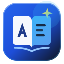

> **1.0.1 修复说明：** 当前安装包采用 Swift / WebView2 + Python 后端。已修复原生页面切换循环等稳定性问题；以下 v1.0 功能描述中，真实 AI 推理、模型下载、截图 OCR、系统划词尚未完整实现。详见 [代码检查与修复记录](docs/BUG_REVIEW_1.0.1.md)。新构建入口为 `.github/workflows/build-installers.yml`，本地构建使用 `python scripts/build_installers.py --platform windows` 或在 Mac 上使用 `--platform macos --arch arm64`（Intel 使用 `--arch x64`）。

<p align="center">
  
</p>

<h1 align="center">AI Dictionary v1.0</h1>

<p align="center">
  <strong>Windows / macOS 双平台本地离线 AI 词典与翻译桌面端（基于 Tencent Hy-MT2 + SQLite FTS5）</strong>
</p>

---

## 核心特性

1. **内置 14,625 条公开中英词库（开箱即用，`< 1ms` 极速查词）**：
   - 默认集成初中、高中、四级 (`CET-4`)、六级 (`CET-6`)、考研、托福 (`TOEFL`)、SAT、`WordNet 3.0`、`CC-CEDICT` 与 `Tatoeba` 双语例句。
   - 持久只读 SQLite `mmap` 映射 + 进程内 `@lru_cache(maxsize=2048)` 热缓存（冷查均值 `2.21ms`，热缓存均值 `0.00076ms`）。
   - 支持英汉互查、词形变化自动还原（如 `Running -> run`）、英美双音标与系统离线 TTS 发音。
2. **有道词典式「系统信息栏 / 托盘常驻 + 关闭主窗口不退出」**：
   - **macOS**：顶部菜单栏 (`NSStatusItem`) 常驻图标 + 左键弹出 `NSPopover` 迷你查词弹窗 + 右键快捷菜单；点击左上角红灯 `×` 仅隐藏主窗口 (`windowShouldClose -> orderOut`)，后台常驻不退出。
   - **Windows**：右下角任务栏托盘 (`NotifyIcon`) 常驻图标 + 左键置顶迷你查词小窗 + 双击恢复主窗口 + 右键上下文菜单；点击右上角 `×` 自动最小化至系统托盘并弹出气泡提示。
3. **Tencent Hy-MT2 本地离线 AI 翻译**：
   - 支持中英互译、自定义术语表强约束 (`F-015`)、Markdown/代码/`{变量}`/URL 结构保护 (`AC-10`) 与新请求抢占取消 (`AC-02`)。
4. **原生内存级截图 OCR 与密码框安全守卫**：
   - 基于 macOS `Vision.framework` / Windows `Media.Ocr` 内存直接识别中英混排文本，零临时图片落盘 (`persistedToDisk = false`)。
   - 自动检测 `AXSecureTextField` / `IsSecureEventInputEnabled()`，在密码框内严禁取词或触发剪贴板回退 (`AC-03`)。
5. **生词本、艾宾浩斯复习与私密模式**：
   - 词库文件 (`dictionary.db`) 与用户个人数据 (`user_data.db`) 物理隔离，升级应用绝不覆盖用户生词本。
   - 支持 CSV / JSON 导入导出、备注编辑及一键私密无痕模式 (`AC-07`)。

---

## 安装包清单 (`dist/installers/`)

| 平台与架构 | 安装包文件 | 大小 | 说明 |
| :--- | :--- | :--- | :--- |
| **macOS Apple Silicon (`arm64`)** | `dist/installers/AI-Dictionary-1.0.0-macOS-arm64.dmg` | `5.08 MB` | 原生 M1/M2/M3/M4 磁盘映像 |
| **macOS Intel (`x86_64`)** | `dist/installers/AI-Dictionary-1.0.0-macOS-x64.dmg` | `5.08 MB` | 原生 Intel Mac 磁盘映像 |
| **macOS Universal (`arm64 + x86_64`)** | `dist/installers/AI-Dictionary-1.0.0-macOS-Universal.pkg` | `4.61 MB` | 双架构通用向导安装包 |
| **Windows 10/11 (`x64`)** | `dist/installers/AI-Dictionary-1.0.0-Windows-x64-Setup.zip` | `3.59 MB` | 含一键安装脚本、右下角托盘常驻程序与卸载脚本 |

---

## 快速开发与构建指令

```bash
# 1. 重新构建 14,625 词条 SQLite FTS5 离线词库
python3 scripts/etl_dictionary.py

# 2. 启动本地服务与 Web 预览 (http://127.0.0.1:1420)
python3 scripts/run_local_server.py --port 1420

# 3. 运行全量自动化验收测试套件 (AC-01~10 & F-001~018)
python3 scripts/verify_acceptance.py

# 4. 一键编译 macOS (arm64 / x64 / Universal) 与 Windows (x64) 安装包
python3 scripts/build_installers.py
```

---

## 文档索引

- [产品需求文档 (AI_Dictionary_PRD_v1.0.md)](./AI_Dictionary_PRD_v1.0.md)
- [技术架构与开发计划 (docs/TECHNICAL_ARCHITECTURE_AND_PLAN.md)](./docs/TECHNICAL_ARCHITECTURE_AND_PLAN.md)
- [开源数据与模型许可证台账 (docs/DATA_LICENSE_LEDGER.md)](./docs/DATA_LICENSE_LEDGER.md)
- [性能基准与全量验收测试报告 (docs/BENCHMARK_REPORT.md)](./docs/BENCHMARK_REPORT.md)
